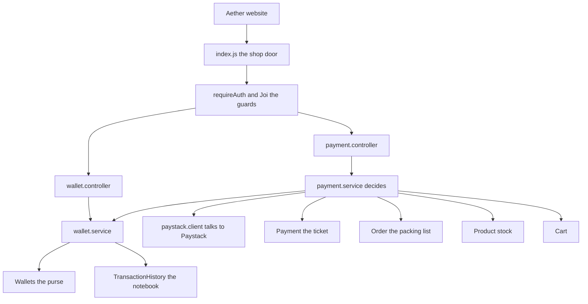
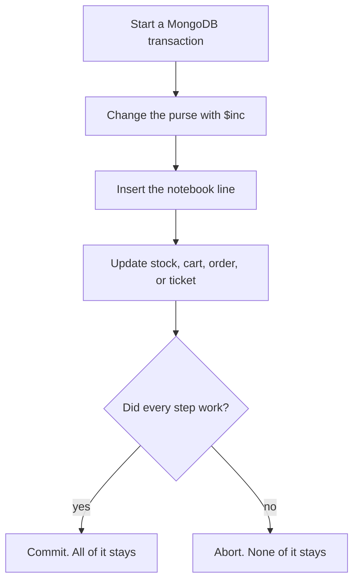
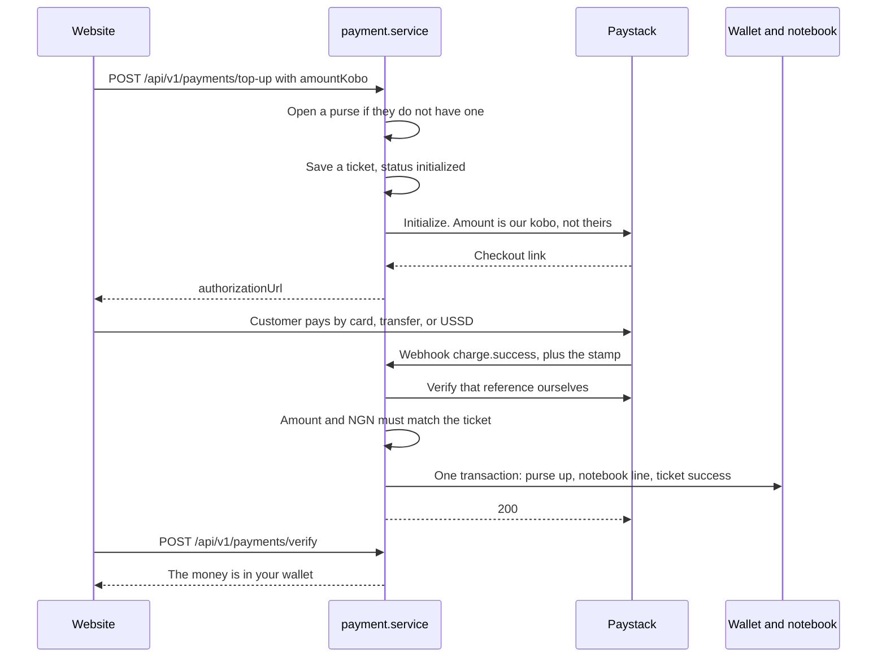
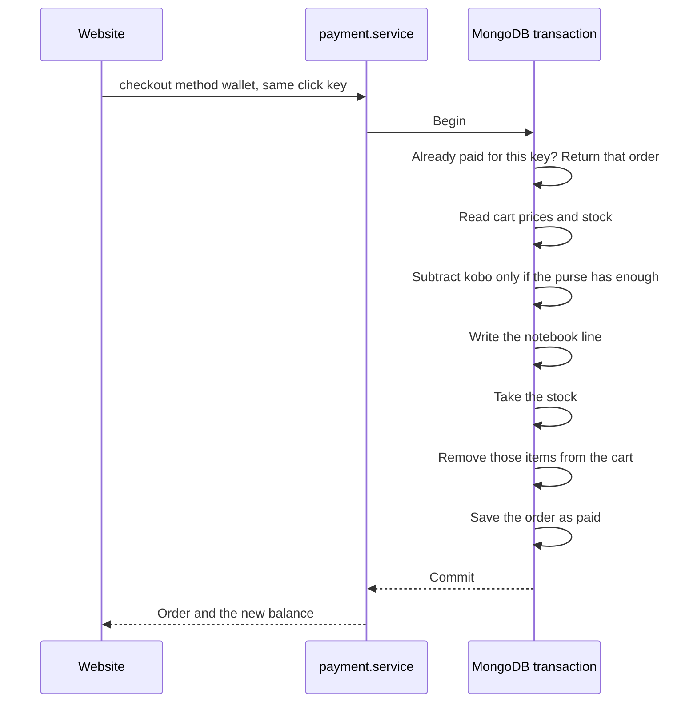
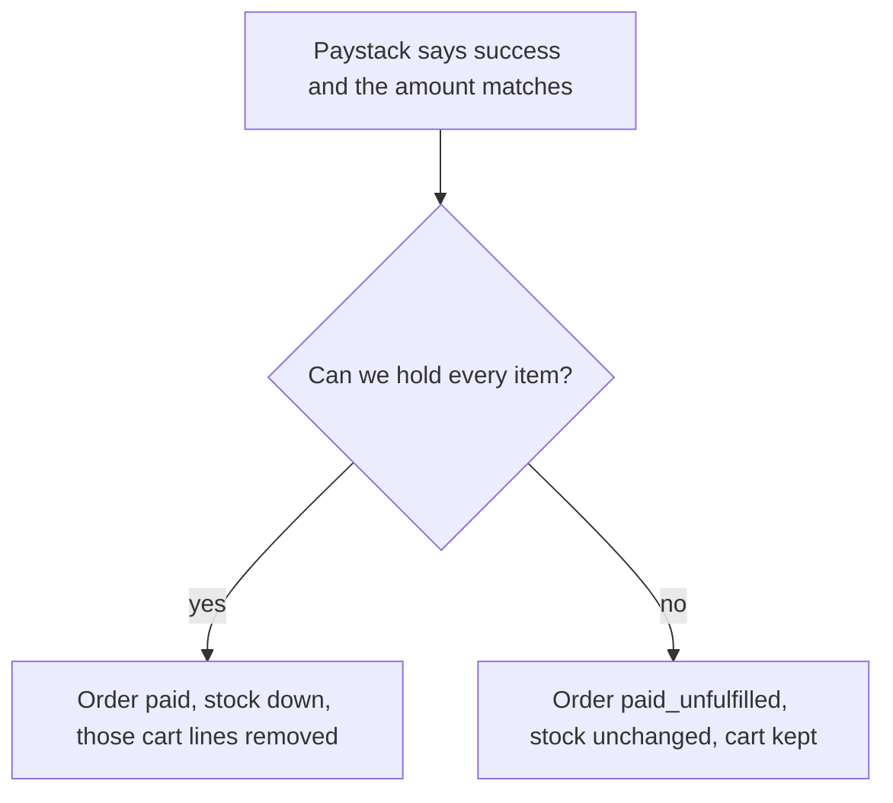
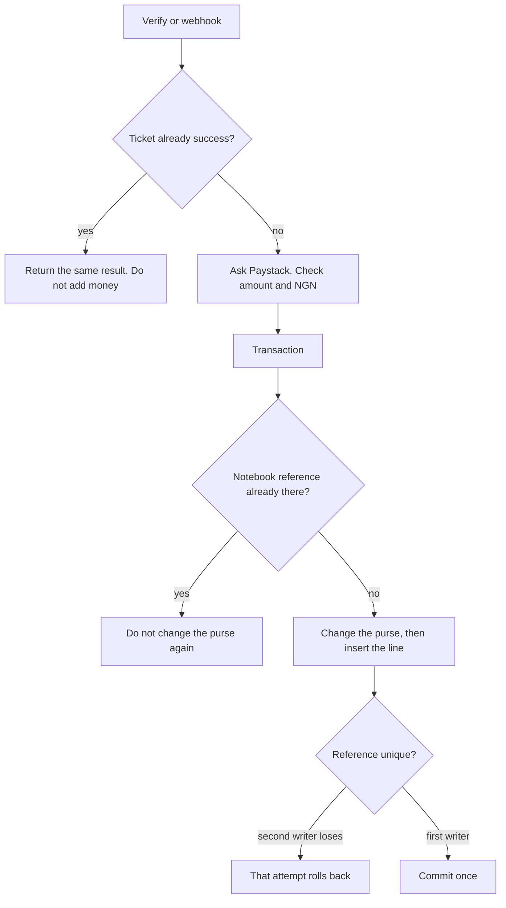

# How the wallet and Paystack payments work

Read this from top to bottom. The pictures show the order of the work. The words under each picture say what the code is doing.

The rest of the shop (signup, products, cart) is in `HOW-THE-BACKEND-WORKS.md`. This file is only the purse and the payments.

Think of the backend as a small shop in Lagos.

- The **purse** is the wallet. It holds that one customer's naira.
- The **notebook** is the transaction history. We only add new lines. We do not rub a line out.
- The **ticket** is the Paystack payment. It is the piece of paper that says "we asked Paystack to collect this money."
- **Paystack** is the person at the POS. The customer can pay by card, bank transfer, or USSD. We do not see their card PIN. Paystack does.

---

## 1. The whole path



A request still walks the same line as the rest of the shop:

`door -> route -> guard -> worker -> service -> shelf`

The worker (controller) does not do the maths. The service does. That way the Paystack door and the website door share one set of rules.

---

## 2. We count kobo, not broken naira

₦1 is 100 kobo.

The phone prices in this shop are already stored as kobo. `89999` means ₦899.99. The wallet uses that same unit. The field is called `balanceKobo`.

We do not store `10.50` as a decimal. Computers are bad at decimals. `10.50` can turn into `10.499999`, and then the purse and the notebook disagree. Whole kobo cannot do that.

| Amount you say | What we store |
| --- | --- |
| ₦1 | 100 |
| ₦100 | 10000 |
| ₦5,000,000 | 500000000 |

The smallest wallet top up is ₦100. The smallest Paystack charge for a cart is ₦50, because that is Paystack's smallest payment. One charge cannot be bigger than ₦5,000,000.

The website is not allowed to tell us the cart total. We read the product prices ourselves and add them up.

---

## 3. Four shelves

### The purse — `src/models/wallets.models.js`

One purse per person. `userId` is unique, so a second purse for the same person is rejected.

| Field | Meaning |
| --- | --- |
| `balanceKobo` | How much is in the purse right now |
| `currency` | Always `NGN`. We do not mix dollars into a naira purse |
| `accountNumber` | A random 10-digit number. It is not made from the phone number |
| `status` | `active` or `frozen`. Frozen means "you cannot spend." Money that already left Paystack can still land |

The old code built the account number from the phone. That was a bad idea. Phone numbers can change, two people can look similar, and the phone number is private. A random number does not tell a stranger your phone.

Opening a purse is safe to retry. If two requests try at the same moment, one wins and the other reads the purse that won.

### The notebook — `src/models/transactionHistory.js`

A line is written only when the purse balance really changes.

| Field | Meaning |
| --- | --- |
| `type` | `credit` means money in. `debit` means money out |
| `purpose` | `topup` or `purchase` |
| `reference` | The receipt number. Unique. The same number cannot be written twice |
| `amountKobo` | How much moved |
| `balanceBeforeKobo` | The purse before this line |
| `balanceAfterKobo` | The purse after this line |
| `provider` | `paystack` or `wallet` |

We do not edit a line. If something was wrong, a later feature would add a new line. That is how a fair exercise book works.

### The ticket — `src/models/payment.models.js`

This is created before the customer pays. The purse does not change yet.

| Status | Meaning |
| --- | --- |
| `initialized` | We asked Paystack. We are waiting |
| `success` | Paystack confirmed the money, and we did our part |
| `failed` | It did not go through, or the amount did not match |
| `abandoned` | The customer left before paying |

`accessCode` and `authorizationUrl` are hidden on normal reads. They are the link that opens Paystack. We hand that link to the website once. We do not leave it lying in every list.

### The packing list — `src/models/order.models.js`

| Status | Meaning |
| --- | --- |
| `pending_payment` | Waiting for Paystack |
| `paid` | Money is confirmed and the items were taken off the shelf |
| `paid_unfulfilled` | Money arrived, but an item sold out before we could hold it |
| `failed` | The Paystack start did not finish |

`paid_unfulfilled` is on purpose. We do not pretend the goods went out. A refund can be added later without guessing.

Each order stores the price at the moment we charged. If a price changes after that, the old charge stays the old charge.

---

## 4. All or nothing

When money moves, these things must finish together:

1. The purse goes up or down.
2. A new notebook line is written, with the balance before and after.
3. For a purchase, the stock goes down and the cart loses those items.
4. The order or the Paystack ticket is marked with the truth.

If NEPA takes the light in the middle, MongoDB throws the whole group away. The purse never changes unless the notebook line exists too.



This lives in `src/helpers/withTransaction.js`. The services call it. They do not invent their own half-save.

The purse change itself is one door: `applyBalanceChange` in `src/services/wallet.service.js`. Nothing else is allowed to add or subtract `balanceKobo`.

A spend uses a condition, not hope:

```text
only subtract if status is active AND balanceKobo is at least the amount
```

Two spends at the same moment cannot both pass that test for the same naira. MongoDB makes one of them wait and try again. If the money is gone, the second one gets "Your wallet does not have enough money."

MongoDB can only keep this promise on a **replica set** (more than one copy of the database working together). If the database is a single lone copy, money routes answer with a clear error instead of saving half a payment. `src/configs/db.js` prints a warning at startup when it notices a lone copy.

---

## 5. Adding money with Paystack

The website never calls Paystack with the secret key. The secret stays in `PAYSTACK_SECRET_KEY` on the server.



Steps that matter:

1. We make our own reference, like `tj_topup_` plus random letters. Paystack must use that reference. We do not trust a reference the browser invents for the amount.
2. We save the ticket before we ask Paystack.
3. Paystack sends the customer back to `FRONTEND_URL/payments/callback?reference=...`. Visiting that page does **not** mean they paid. The page asks our server. The server asks Paystack.
4. Paystack also knocks on `POST /api/v1/payments/webhook`. Either knock can finish the job. The second knock finds the work already done and does not add the money again.

### The stamp

Paystack signs the raw body with HMAC SHA512 and our secret key. The header is `x-paystack-signature`.

`index.js` keeps the raw body for that one URL before JSON parsing, because the stamp is on the exact bytes, not on a rebuilt object.

`signaturesMatch` in `src/services/paystack.client.js` compares the stamp in a way that does not stop early when a guess is wrong. A bad stamp gets `401`. We do not credit anything.

After the stamp matches, we still call Paystack's verify endpoint. The webhook body is not the only witness. Verify must say `success`, the reference must be ours, the currency must be `NGN`, and the amount must equal `payment.amountKobo`.

If the amount does not match, we mark the ticket failed and we do not touch the purse. A person must not pay ₦100 and have us write ₦10,000.

Paystack fees stay on the ticket as `feesKobo`. We do not subtract them from the customer's top up. They paid ₦1,000. The purse gets ₦1,000. The fee is our cost, not theirs.

---

## 6. Paying for the cart

`POST /api/v1/payments/checkout`

The body has two fields:

| Field | Meaning |
| --- | --- |
| `method` | `wallet` or `paystack` |
| `idempotencyKey` | A key the website keeps for that one click |

The idempotency key means "this click." If the response gets lost and the website tries the same key again, we return the same order. We do not charge twice.

### Pay with the purse



If the stock disappears in the middle, the whole transaction is thrown away, including the subtraction. The purse does not pay for goods we could not hold.

The cart total is calculated inside the transaction, from the product documents, not from the website.

### Pay with Paystack

1. We price the cart and save an order as `pending_payment`, plus a ticket.
2. We ask Paystack for a checkout link and send the customer there.
3. When verify or the webhook says success, one transaction does this:
   - If the ticket is already `success`, stop.
   - Try to take every item's stock.
   - If an item is gone, put back any stock this attempt already took, mark the order `paid_unfulfilled`, and do not empty the cart.
   - If the stock is there, remove those items from the cart and mark the order `paid`.
4. The purse is not part of a Paystack cart payment. That money goes to the shop through Paystack, not through the purse. The notebook only records purse changes, so this path does not write a fake purse line.



---

## 7. Why a second knock does not double the money

Paystack may knock twice. The website may also call verify. Both call `confirmPayment`.



The receipt number is unique in the database. Two transactions cannot both keep a line with the same number. The loser is rolled back, so its purse change disappears too.

`withTransaction` may also retry if MongoDB is not sure the commit arrived. The first lines of the transaction look for an order or a ticket that is already finished, and then they stop.

---

## 8. The doors

All of these need a logged-in, verified user, except the webhook.

| Method and path | What it does |
| --- | --- |
| `POST /api/v1/wallets` | Open my purse. If I have one, return it |
| `GET /api/v1/wallets` | Return my purse. Open one if I have none |
| `GET /api/v1/wallets/transactions?limit=20&cursor=` | Notebook lines, newest first |
| `POST /api/v1/payments/top-up` | Start a Paystack top up |
| `POST /api/v1/payments/checkout` | Pay the cart with the purse or with Paystack |
| `POST /api/v1/payments/verify` | Confirm a reference that belongs to me |
| `POST /api/v1/payments/webhook` | Paystack only. Checked by stamp, not by login |
| `GET /api/v1/orders/:orderId` | My packing list |

`/create-wallet` and `/get-wallet` still work. They call the same functions. New code should use the shorter paths.

Verify will not show another person's ticket. If the reference is not yours, the answer is "not found."

Top up, checkout, and verify are rate limited in this one server's memory: a burst of clicks gets "Too many tries." The webhook is not limited, because we must not ignore Paystack.

Joi checks the shape before the worker runs. Amounts must be whole numbers inside the kobo limits. Unknown fields are stripped.

---

## 9. Which file does which job

```text
backend/
  index.js                         keeps the raw webhook body, hangs the routes
  src/configs/db.js                warns if MongoDB cannot do all-or-nothing
  src/models/wallets.models.js     the purse
  src/models/transactionHistory.js the notebook
  src/models/payment.models.js     the Paystack ticket
  src/models/order.models.js       the packing list
  src/services/wallet.service.js   open a purse, list lines, the only balance door
  src/services/paystack.client.js  HTTP to Paystack, and the stamp check
  src/services/payment.service.js  top up, checkout, verify, webhook
  src/services/order.service.js    read one order for its owner
  src/controllers/                 thin workers: call a service, send JSON
  src/routes/                      the URLs
  src/validators/                  Joi shapes
  src/helpers/money.js             the kobo limits
  src/helpers/withTransaction.js   all-or-nothing
  src/helpers/reference.js         receipt numbers and account numbers
  src/middlewares/error.js         safe error JSON
  src/middlewares/rateLimit.js     slows repeated clicks
```

`src/payments.test.js` checks the stamp, the shape of receipt numbers, and that the kobo limits are whole numbers. It does not need a database. From the `backend` folder, run `npm test`.

---

## 10. The four worries, in plain words

### Easy to change later (maintainability)

Each toy is in a labeled box.

- Paystack's web address and secret live only in `paystack.client.js`. A new payment company would be a new client, not a rewrite of the cart.
- The purse balance changes in one function. A bug in "how much" has one place to look.
- Controllers do not hide rules. The rules are in the services, so a webhook and a button obey the same function.
- Money limits live in `money.js`, and Joi reads those same numbers.

The cost is more files. That is the same trade the rest of this backend already made.

### Does not fall over when more people come (scalability)

- Each customer has their own purse. We do not keep everyone's money in one document that every payment must queue on.
- The notebook is read with a cursor (`_id` of the last line), not "skip 10,000 rows." Older lines are another small page.
- The hot document is one person's purse. Two of their own payments can still collide, and the transaction retries. That is correct. It is not a shop-wide queue.
- The click limiter is counted in this process's memory. A second server would count separately. Before a big launch, that limiter should move to a shared store, or sit at the gateway.
- Verify and the webhook do the work inside the request. That is fine at this size. `confirmPayment` is one function, so a queue worker can call it later without teaching the queue about purses.

### Hard to cheat (security)

- The Paystack secret is never sent to the website.
- The webhook is rejected without a valid stamp.
- We check the amount and the currency against our ticket. The browser cannot name a bigger amount.
- Checkout ignores any total the browser might send. We price the cart.
- A customer can verify only their own reference.
- The checkout link fields are hidden from ordinary queries.
- Login tokens are not printed in the server log. Printing them would be like writing the house key on the door.
- Errors that we did not plan become "Internal server error." We do not send Paystack's private reply, or a stack trace, to the browser.
- The purse cannot go below zero. The database condition is the lock, not a check-then-hope in JavaScript.

### Room to grow (extendability)

- A refund is a new notebook line through the same balance door (`credit`, a new purpose). It is not a new way of editing the purse. The door is the extension point. The refund itself is not built yet.
- `paid_unfulfilled` means "money landed, goods did not." A refund job can find those orders without reading stories in a log.
- Currency is only `NGN`. A second currency should be a second purse, not a mixed balance. Mixing them is how the maths starts lying.
- `provider` on the notebook line can be a new name when a second payment company arrives.
- Prices on the order are a copy. Later edits to the catalog do not rewrite history.

What is deliberately not built, so nobody thinks it is:

- Automatic refunds when Paystack reverses a charge after we already marked it successful.
- Splitting a payment to another shop.
- Subscriptions.
- A sweeper that closes old unpaid tickets. A Paystack link that never saved, and is older than a minute, is failed so the customer can try again. Older unpaid tickets otherwise stay `initialized` until Paystack tells us they failed or were abandoned.

---

## 11. What you put in the environment

In `backend/.env`:

```text
PAYSTACK_SECRET_KEY=sk_test_...
FRONTEND_URL=http://localhost:5173
MONGODB_URL=...a replica set connection...
```

`PAYSTACK_SECRET_KEY` is the secret key, the one that starts with `sk_`. The public key is not used, because the server creates the charge and the website only opens the link Paystack gives back.

In the Paystack dashboard, the webhook URL is:

```text
https://your-server/api/v1/payments/webhook
```

Use the test secret and test cards until a real payment is meant to move real naira.

The database must be a replica set. On a lone MongoDB, the purse routes will refuse to move money rather than save half of it.
